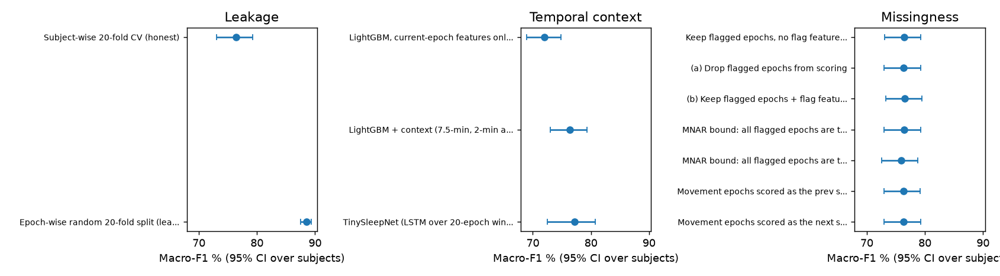

# Evaluation

All results are in [summary.csv](summary.csv): one row per experiment × model, with 95% CIs from a bootstrap
over subjects. The columns are described in [`data/DATA_DICTIONARY.md`](../data/DATA_DICTIONARY.md) section 6.

## Protocol

- **Data:** Sleep-EDF-20, EEG Fpz-Cz, the 42,308 epochs of the AttnSleep / DeepSleepNet protocol
  ([data/README.md](../data/README.md)).
- **Subject-wise 20-fold CV:** leave one subject out, with the same folds for every model
  (`data/splits/sleepedf20_folds.json`). No subject is ever in both training and test, and
  `tests/test_data.py` asserts this. In each fold, 2 of the 19 training subjects are held out as
  validation subjects. They are used only for early stopping and checkpoint choice.
- **Metrics:** accuracy, macro-F1, Cohen's kappa and per-class F1, pooled over all test folds (as the papers
  report them).
- **Uncertainty:** 95% CIs come from 1,000 bootstrap resamples of subjects (not epochs). Models trained with
  several seeds are reported as the seed mean, with their seed range.
- **No test-fold tuning:** epochs, checkpoints and early stopping are chosen on the validation subjects only.
  Normalisation is per recording and uses no labels, so nothing is fitted on test subjects.
- **Deep runs are imported, not retrained:** the deep models were trained once with the exact settings in
  `configs/exp1_main.yaml`. `make exp1` imports those runs (`src/deep/import_runs.py`). On a fresh clone the
  saved runs are not there (they are not in git), and `make exp1` trains them with the same config instead
  (GPU, about 1-2 h per model and seed). The import:
  - checks the saved config against the experiment config, key by key;
  - checks every protocol epoch and fold;
  - records SHA256 provenance.

  `make verify-imports` reloads every checkpoint with the current code and re-predicts
  each test subject. For all 4 runs (AttnSleep, TinySleepNet × 3 seeds) the predictions are identical
  (maximum probability difference 0.0, `results/exp1_main/*/seed*/verify.json`).
  The training code was checked the same way: retraining fold 0 of AttnSleep and TinySleepNet (seed 42) with the
  current code gives the same epochs, the same training losses and the same predictions as the saved runs.

## Main result (exp1)

All four models under the same folds; tables are written by `analysis.ipynb` from `summary.csv`.

<!-- BEGIN:main -->
| Model | Acc % | Macro-F1 % | Kappa | F1 W | F1 N1 | F1 N2 | F1 N3 | F1 REM | Seeds |
|---|---|---|---|---|---|---|---|---|---|
| LightGBM, YASA-style features + neighbouring-epoch context | 82.4 [79.7, 84.9] | 76.4 [73.0, 79.3] | 0.760 [0.723, 0.794] | 85.9 | 41.7 | 87.2 | 87.9 | 79.3 | 1 seed |
| AttnSleep reproduction (epoch chosen on validation subjects) | 81.4 [78.7, 83.8] | 75.8 [73.0, 78.2] | 0.747 [0.711, 0.780] | 86.1 | 40.6 | 87.3 | 88.7 | 76.1 | 1 seed |
| TinySleepNet (CNN + LSTM, 20-epoch windows) | 82.0 [77.6, 85.4] | 77.2 [72.5, 80.7] | 0.758 [0.699, 0.802] | 86.2 | 47.7 | 85.6 | 82.9 | 83.4 | mean of 3 seeds (acc range 81.8-82.5) |
| seqctx_transformer (TinySleepNet CNN + Transformer; own design) | 83.4 [79.6, 86.4] | 78.7 [74.8, 81.8] | 0.776 [0.724, 0.816] | 87.5 | 50.5 | 86.3 | 83.3 | 85.7 | mean of 3 seeds; chosen as our best deep model after seeing test results (selection bias) (acc range 82.5-84.3) |
| *AttnSleep, published (Eldele et al. 2021, Table V)*¹ | 84.4 | 78.1 | 0.79 | 89.7 | 42.6 | 88.8 | 90.2 | 79.0 | n/a |

Is the published value inside our 95% CI? (inside = "matches")

- lgbm: acc inside, macro-F1 inside, kappa inside
- attnsleep: acc above, macro-F1 inside, kappa above
- tinysleepnet: acc inside, macro-F1 inside, kappa inside
- seqctx_transformer: acc inside, macro-F1 inside, kappa inside
<!-- END:main -->

## Model selection: what was fixed in advance and what was not

- **Fixed in advance:**
  - LightGBM uses YASA's published hyperparameters and class weights;
  - AttnSleep and TinySleepNet use their repositories' settings;
  - every model uses the same folds.
- **Chosen after seeing test results: `seqctx_transformer`.** It is our own design (TinySleepNet's CNN plus a
  2-layer Transformer over 20 epochs). It was picked as "our best deep model" after the test-fold results of
  several deep variants were known, which is selection bias. Other variants were tried and are not in this
  repository. To limit that bias:
  - it is reported as the **mean of its 3 training seeds**, not its best seed (seed 42 is also its best:
    84.3% vs 82.5% and 83.4%, `summary.csv` seed columns);
  - `summary.csv` labels it in the `note` column.

  A clean test would fix it as it is and evaluate it once on new subjects, for example those in Sleep-EDF-78
  but not in Sleep-EDF-20.

## Why our AttnSleep reproduction scores below the paper

Our AttnSleep scores 81.4% accuracy (`summary.csv`); the paper reports 84.4% (Eldele et al. 2021, IEEE TNSRE,
Table V). The gap has several known causes:

1. **The paper picks its reported epoch on the test fold.** The repository keeps the epoch with the best
   *test* accuracy (`trainer.py`, `selected_d`). Our run also scored the test subject after every epoch, for
   this audit only, never for selection. Choosing the epoch the paper's way raises our pooled accuracy from
   81.4% to 83.1%, which is **+1.8 points**
   ([attnsleep_selection_audit.json](attnsleep_selection_audit.json); per fold:
   [attnsleep_selection_audit.csv](attnsleep_selection_audit.csv)). This is a lower bound, because:
2. **We train for fewer epochs.** We stop early after at most 40 epochs (the longest fold ran 30). The repo
   trains 100 epochs and then picks the best one on test, so it has more epochs to pick from. In 7 of our
   20 folds, the epoch chosen on validation came before the learning-rate step at epoch 10.
3. **We hold out validation subjects.** We train on 17 subjects per fold instead of 19.
4. **The repo's class weights use test labels.** It counts train + test labels; we count training labels only.
5. **The paper's hyperparameters were chosen "across these folds"** (paper p. 815), which is also test-fold
   tuning.

After item 1, about 1.3 points remain. That is inside our CI (78.7-83.8%) and comparable to seed-to-seed
variation, and we did not separate it further.

## Leakage (exp2)

The same LightGBM, with the same seed and the same 42,308 epochs, under two splits. The epoch-wise split puts
neighbouring epochs of the same night into training and test, which a real new patient would never allow.

<!-- BEGIN:leakage -->
| | Epochs | Acc % | Macro-F1 % | Kappa | F1 N1 % |
|---|---|---|---|---|---|
| Subject-wise 20-fold CV (honest) | 42,308 | 82.4 [79.7, 84.9] | 76.4 [73.0, 79.3] | 0.760 [0.723, 0.794] | 41.7 [31.9, 49.1] |
| Epoch-wise random 20-fold split (leaky) | 42,308 | 92.0 [91.3, 92.7] | 88.5 [87.5, 89.3] | 0.890 [0.880, 0.899] | 68.3 [64.1, 71.5] |
| **Inflation (epoch - subject)** | | +9.6 pp | +12.1 pp | +0.130 | +26.6 pp |
<!-- END:leakage -->

The leaky split makes a feature model look better than every published deep model. N1, the rarest stage,
gains the most.

## Temporal context (exp3)

How much do neighbouring epochs help?
- **LightGBM** is shown without and with its context features (7.5-min, 2-min and ±2-epoch rolling windows,
  plus time of night).
- **TinySleepNet** gets its context from an LSTM over 20-epoch windows.

<!-- BEGIN:context -->
| | Epochs | Acc % | Macro-F1 % | Kappa | F1 N1 % |
|---|---|---|---|---|---|
| LightGBM, current-epoch features only (no context) | 42,308 | 79.4 [76.4, 82.1] | 72.0 [68.9, 74.9] | 0.720 [0.680, 0.755] | 29.6 [20.7, 37.4] |
| LightGBM + context (7.5-min, 2-min and +-2-epoch windows, time of night) | 42,308 | 82.4 [79.7, 84.9] | 76.4 [73.0, 79.3] | 0.760 [0.723, 0.794] | 41.7 [31.9, 49.1] |
| TinySleepNet (LSTM over 20-epoch windows), mean of 3 seeds | 42,308 | 82.0 [77.6, 85.4] | 77.2 [72.5, 80.7] | 0.758 [0.699, 0.802] | 47.7 [39.5, 54.4] |
<!-- END:context -->

Context is worth about 3 points of accuracy and 12 points of N1 F1 for LightGBM. With context, the feature
model and the sequence model are within each other's CIs.

## Missingness (exp4)

The missingness mechanisms and their evidence are in [data/data_quality.md](../data/data_quality.md). This
experiment checks whether the handling choices change the results, all with the main LightGBM:
- **Artifacts:** the 195 artifact-flagged Fpz-Cz epochs (assumed MAR given the stage, MNAR for a deployed
  model) are either (a) dropped from scoring, or (b) kept, with the 3 flags added as model features.
- **MNAR bounds:** every flagged epoch is assumed to be truly W, or truly N1 (the worst case for macro-F1).
- **Movement epochs:** the 61 Movement epochs inside the scored window (MAR) are scored as the previous stage
  or the next stage, instead of being excluded.

<!-- BEGIN:missingness -->
| | Epochs | Acc % | Macro-F1 % | Kappa | F1 N1 % |
|---|---|---|---|---|---|
| Keep flagged epochs, no flag feature (main model) | 42,308 | 82.4 [79.7, 84.9] | 76.4 [73.0, 79.3] | 0.760 [0.723, 0.794] | 41.7 [31.9, 49.1] |
| (a) Drop flagged epochs from scoring | 42,113 | 82.3 [79.6, 84.8] | 76.4 [73.0, 79.3] | 0.759 [0.722, 0.793] | 41.7 [31.9, 49.1] |
| (b) Keep flagged epochs + flag features | 42,308 | 82.6 [80.0, 85.1] | 76.6 [73.2, 79.5] | 0.764 [0.728, 0.797] | 41.5 [31.6, 48.9] |
| MNAR bound: all flagged epochs are truly W | 42,308 | 82.4 [79.6, 84.9] | 76.4 [73.0, 79.3] | 0.760 [0.723, 0.794] | 41.7 [31.9, 49.1] |
| MNAR bound: all flagged epochs are truly N1 | 42,308 | 81.9 [79.2, 84.4] | 75.9 [72.6, 78.8] | 0.754 [0.718, 0.788] | 40.4 [31.2, 47.7] |
| Movement epochs scored as the prev stage | 42,369 | 82.3 [79.6, 84.8] | 76.4 [73.0, 79.2] | 0.760 [0.723, 0.794] | 41.7 [31.8, 49.1] |
| Movement epochs scored as the next stage | 42,369 | 82.3 [79.6, 84.8] | 76.4 [73.0, 79.2] | 0.760 [0.723, 0.794] | 41.6 [31.8, 49.1] |
<!-- END:missingness -->

**No handling choice or bound moves accuracy, macro-F1 or kappa by more than about half a point**, well inside
the CIs. N1 F1 moves the most: down 1.3 points if every flagged epoch were truly N1. The conclusions do not
depend on how the missing data are handled. Caveats:
- Arm (a) removes flagged epochs from scoring only; the model was trained with them.
- The high-amplitude flag uses each night's scored epochs as its reference (data/data_quality.md section 3).

## Limitations

- **20 subjects.** CIs are several points wide: we can say "matches", but not that one model beats another.
- **Post-hoc choice.** seqctx_transformer was singled out after seeing test results, and the 3-seed mean only
  softens this. A clean test would evaluate it once on new subjects.
- **Seed variance is not in the CIs.** Only the two sequence models have 3 seeds; their seed range is about
  1-2 points.
- **The protocol uses labels to choose the scored window** (the wake trim), as the papers do. The numbers
  therefore overstate performance on full nights, and on patients rather than healthy adults.
- **AttnSleep gap:** about 1.3 points of the gap remain after correcting for the paper's test-fold epoch
  choice, and they are not explained.
